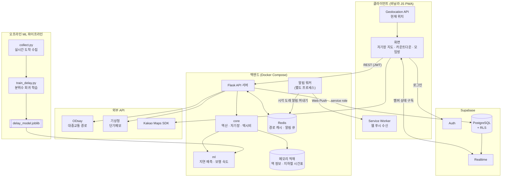
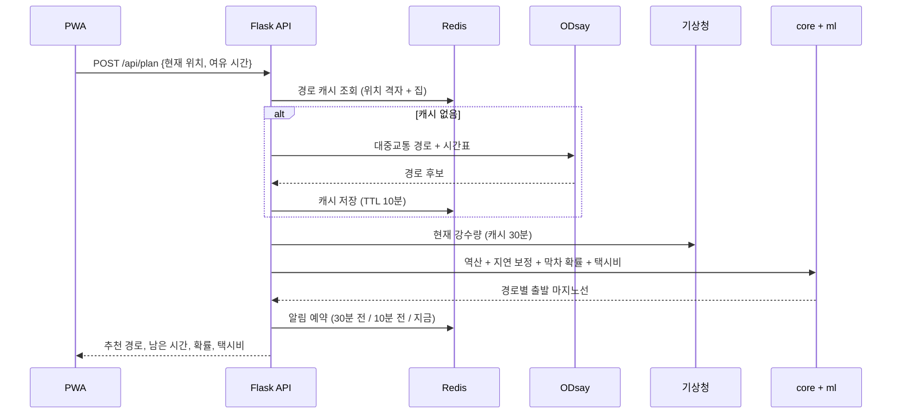
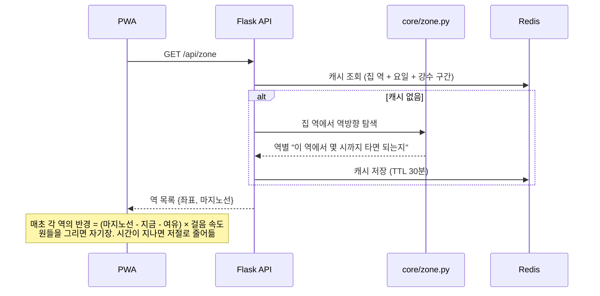
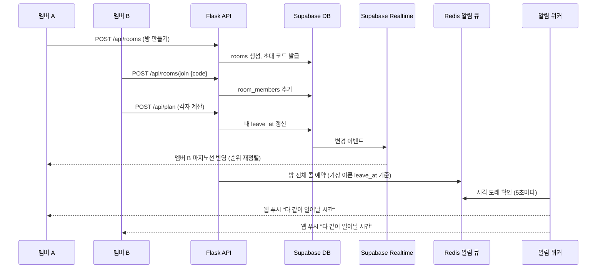
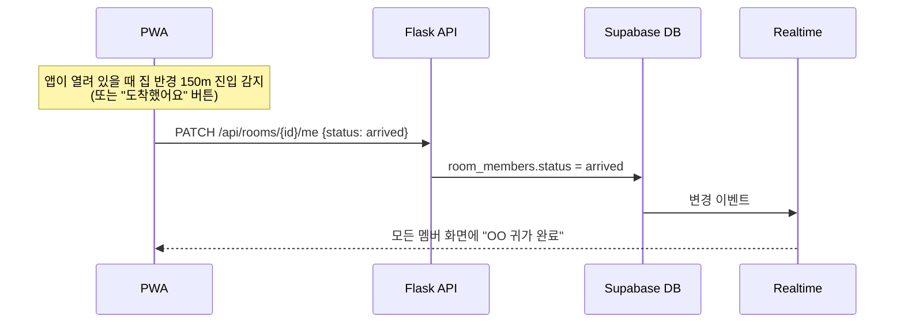
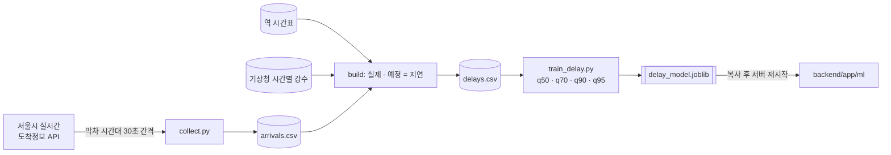
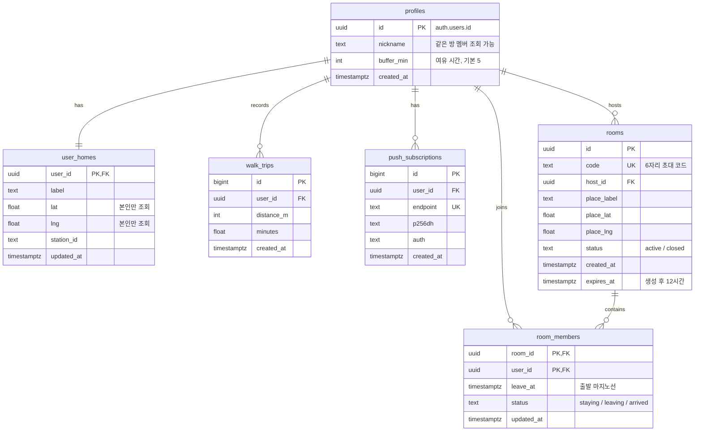

# 🚇 막차 자기장

> 앗차가 **나의 막차가 몇 시인지** 알려준다면, 막차 자기장은 **우리 모임이 어디까지 괜찮은지** 보여준다.

술자리, 모임 중에 "지금 어디에 있어야 집에 갈 수 있는지"를 지도 위 **줄어드는 자기장**으로 보여주는 귀가 도우미 웹앱(PWA)입니다. 친구들의 자기장을 겹쳐 모두가 안전한 구역을 찾고, 가장 먼저 일어나야 하는 사람 기준으로 **모든 폰을 동시에 울려** 아무도 눈치 보지 않고 일어날 수 있게 합니다.

---

## 목차

1. [핵심 기능](#1-핵심-기능)
2. [기술 스택](#2-기술-스택)
3. [시스템 아키텍처](#3-시스템-아키텍처)
4. [폴더 구조](#4-폴더-구조)
5. [데이터 흐름](#5-데이터-흐름)
6. [핵심 알고리즘](#6-핵심-알고리즘)
7. [DB 설계](#7-db-설계)
8. [API 명세](#8-api-명세)
9. [실행 방법](#9-실행-방법)
10. [제약 사항과 대응](#10-제약-사항과-대응)
11. [개발 일정](#11-개발-일정)

---

## 1. 핵심 기능

| 우선순위 | 기능 | 설명 | 기존 앱(앗차)과의 차이 |
|---|---|---|---|
| P0 | 막차 역산 | 현재 위치에서 집까지 "몇 시에 일어나야 하는지" 계산 | 기본 기능 (동일) |
| P0 | **막차 자기장 지도** | 귀가 가능한 구역을 지도에 표시, 시간이 지날수록 줄어듦 | "몇 시"가 아니라 "어디까지"를 보여줌 |
| P0 | 모임방 | 초대 코드로 입장, 멤버별 남은 시간 실시간 정렬 | 개인이 아닌 모임 단위 |
| P0 | **다 같이 일어나기 콜** | 가장 빠른 마지노선에 맞춰 모든 멤버 폰을 동시에 알림 | 눈치 문제 해결 |
| P1 | 자기장 교집합 | 모든 멤버가 안전한 구역 계산 → 2차 장소 고르기 | 모임 장소 의사결정 지원 |
| P1 | **AI 지연 예측 / 막차 확률** | 지연을 분위수 회귀로 예측, "이 경로로 막차 탈 확률 94%" | 시간표가 아닌 확률 기반 |
| P1 | 택시비 미터기 | 머무는 시간을 놓칠 경우의 택시비로 환산 (손실 회피 넛지) | 행동경제학 기반 알림 |
| P2 | 안심 귀가 체크 | 각자 집 도착 시 모임방에 "귀가 완료" 표시 | 귀가 후까지 책임 |
| P2 | 개인 보행 속도 학습 | 실제 이동 기록으로 걸음 속도 보정 (베이지안 축소 추정) | 개인화 |

---

## 2. 기술 스택

| 영역 | 기술 | 선택 이유 |
|---|---|---|
| 프론트엔드 | 바닐라 JavaScript(ES 모듈) + HTML + CSS, 서비스 워커(PWA) | 빌드 도구 없이 바로 실행되고, 홈 화면 추가 시 앱처럼 동작. 화면 수가 적어 프레임워크가 필요 없음 |
| 지도 | Kakao Maps JavaScript SDK | 국내 지도, 원/다각형 그리기 지원 |
| 백엔드 | Flask (Python 3.11) | ML 모델과 같은 언어, 팀이 사용해본 프레임워크. 개발 중에는 프론트 파일도 함께 서비스 |
| DB / 인증 / 실시간 | Supabase (PostgreSQL, Auth, Realtime) | 직접 서버를 운영하지 않고 RLS로 권한 제어 |
| 캐시 / 알림 큐 | Redis | 경로 캐싱, Sorted Set 기반 알림 예약 |
| 푸시 | Web Push (VAPID) + pywebpush | 앱스토어 없이 폰 알림 |
| 공간 연산 | H3 (육각형 격자) | 자기장 교집합 계산 |
| ML | scikit-learn (GradientBoosting 분위수 회귀) | 데이터가 적어도 안정적, 해석 가능 |
| 외부 API | ODsay(대중교통), 기상청 단기예보, 서울시 실시간 지하철 도착정보 | 경로, 날씨, 지연 학습 데이터 |
| 배포 | Docker Compose on VM(백엔드, Redis, 워커), 프론트는 Flask 또는 정적 호스팅, Supabase Cloud | HTTPS 필수(위치, 푸시) 충족 |

---

## 3. 시스템 아키텍처



### 구성 요소 역할

| 구성 요소 | 역할 |
|---|---|
| 바닐라 JS PWA | 위치 수집, 자기장 지도 렌더링, 카운트다운, 모임방 화면, 푸시 구독 |
| Flask API | 인증 확인, 역산/자기장 계산 요청 처리, 모임방 관리, 알림 예약 |
| core | 서비스의 두뇌. 역산 알고리즘, 역방향 탐색(자기장), 택시비 추정, 막차 확률 |
| ml | 학습된 지연 예측 모델 로드/추론, 개인 보행 속도 추정 |
| 알림 워커 | Redis 알림 큐를 주기적으로 확인해 시각이 된 알림을 웹 푸시로 발송 |
| Redis | 외부 API 결과 캐싱(호출 수 절감), 알림 예약 큐(Sorted Set) |
| 메모리 적재 데이터 | 서버 시작 시 역 좌표와 지하철 시간표를 메모리에 올려 자기장 계산을 빠르게 수행 |
| Supabase | 회원, 모임방, 멤버 상태 저장. 멤버 상태 변경을 Realtime으로 모든 멤버에게 전달 |
| 오프라인 ML | 막차 시간대 실제 도착 기록을 수집하고 주기적으로 재학습 |

---

## 4. 폴더 구조

```
lasttrain-zone/
├── README.md
├── docker-compose.yml          # api, worker, redis
├── .env.example                # 필요한 환경 변수 목록 (실제 키는 커밋 금지)
├── .gitignore
│
├── frontend/                   # 바닐라 JS + HTML + CSS (PWA, 빌드 도구 없음)
│   ├── index.html              # 시작 화면
│   ├── sw.js                   # 서비스 워커
│   ├── css/
│   │   └── global.css
│   ├── html/                   # 화면별 HTML
│   │   ├── login.html / signup.html / onboarding.html
│   │   ├── dashboard.html          # 나(막차 역산) / 우리 테이블(모임) / 내 걸음
│   │   ├── join.html               # 초대 링크·코드 입장
│   │   └── profile.html            # 내 정보, 서버 연결 확인
│   ├── public/                 # manifest, PWA 아이콘
│   └── src/js/                 # 화면별 스크립트 (ES 모듈)
│       ├── config.js               # Supabase 공개 키, 백엔드 주소 (비밀 키 금지)
│       ├── supabase.js / db.js     # Supabase 직접 통신 (RLS 로 보호)
│       ├── api.js                  # Flask 호출 (로그인 토큰 자동 첨부)
│       ├── account.js              # 가입, 로그인, 탈퇴
│       ├── rooms.js                # 모임 만들기, 입장, 멤버, 막차 입력
│       ├── planner.js / transit.js / clock.js
│       └── dashboard.js, profile.js, join.js ...   # 화면별 진입 스크립트
│
├── backend/                    # Flask
│   ├── Dockerfile
│   ├── requirements.txt
│   ├── wsgi.py                 # gunicorn 진입점
│   ├── worker.py               # 알림 워커 진입점
│   ├── data/
│   │   ├── stations.csv        # 수도권 역 좌표 (공공데이터)
│   │   └── timetables/         # 노선별 시간표 (공공데이터 가공)
│   ├── app/
│   │   ├── __init__.py         # create_app(), 시작 시 시간표/모델 메모리 적재
│   │   ├── config.py
│   │   ├── auth.py             # Supabase JWT 검증 데코레이터 (ES256 JWKS / HS256)
│   │   ├── api/                # Blueprint (요청/응답만 담당, 로직 없음)
│   │   │   ├── me.py               # 로그인한 나 확인
│   │   │   ├── plan.py
│   │   │   ├── zone.py
│   │   │   ├── rooms.py
│   │   │   ├── push.py
│   │   │   ├── walk.py
│   │   │   └── health.py
│   │   ├── core/               # 순수 로직 (외부 의존 없음 → 테스트 쉬움)
│   │   │   ├── last_train.py       # 역산 알고리즘
│   │   │   ├── zone.py             # 역방향 탐색 + 자기장 원 + H3 교집합
│   │   │   ├── probability.py      # 막차 확률
│   │   │   └── taxi.py             # 택시 요금 추정
│   │   ├── ml/
│   │   │   ├── features.py         # 학습/추론 공통 특징 (ml/train_delay.py 와 동일)
│   │   │   ├── delay_model.py      # 모델 로드 / 추론
│   │   │   ├── walk_speed.py       # 베이지안 축소 추정
│   │   │   └── models/             # delay_model.joblib 위치
│   │   ├── services/           # 외부 연동
│   │   │   ├── transit_client.py   # ODsay
│   │   │   ├── weather_client.py   # 기상청
│   │   │   ├── db.py               # Supabase (service role)
│   │   │   ├── cache.py            # Redis 캐시
│   │   │   └── alert_queue.py      # Redis Sorted Set 알림 예약/취소
│   │   └── schemas.py          # 요청/응답 검증 (pydantic)
│   └── tests/
│       ├── test_last_train.py
│       ├── test_zone.py
│       └── test_probability.py
│
├── ml/                         # 오프라인 학습 (서비스와 분리)
│   ├── collect.py              # 실시간 도착 수집 + 학습 데이터 생성
│   ├── make_fake_data.py       # 개발용 가짜 데이터
│   ├── train_delay.py          # 분위수 회귀 학습/평가
│   ├── data/                   # (gitignore) 수집 데이터
│   └── models/                 # 학습 결과 → backend로 복사
│
└── docs/
    ├── api.md                  # 상세 API 명세
    ├── sql/                    # Supabase 에서 실행할 SQL (예: 004_room_last_trains.sql)
    └── presentation/           # 발표 자료, 시연 영상
```

### 레이어 규칙

- `api/`는 요청을 검증하고 `core/`, `services/`를 호출해 응답만 만든다. **비즈니스 로직을 넣지 않는다.**
- `core/`는 외부 API, DB, Redis를 직접 부르지 않는다. 입력을 받아 계산 결과만 돌려주므로 단위 테스트가 쉽다.
- `services/`만 외부 세계(ODsay, 기상청, Supabase, Redis)와 통신한다.

---

## 5. 데이터 흐름

### 5-1. 내 막차 계산 (홈 화면)



- 위치는 **50m 이상 이동했을 때만** 다시 요청해 API 호출을 줄인다.
- 다시 계산되면 기존 알림을 지우고 새 시각으로 예약한다.

### 5-2. 자기장 계산



- 서버는 **역별 마지노선만** 내려주고, 반경은 클라이언트가 매초 계산한다. 서버 호출 없이 자기장이 실시간으로 줄어든다.

### 5-3. 모임방과 다 같이 일어나기



- 멤버의 **집 좌표는 다른 멤버에게 절대 전달하지 않는다.** 공유되는 값은 `leave_at`(출발 마지노선)과 `status`뿐이다.
- 교집합 자기장은 서버가 멤버별 자기장을 H3 격자로 바꿔 교집합 셀만 내려준다.

### 5-4. 안심 귀가



### 5-5. ML 학습 (오프라인)



---

## 6. 핵심 알고리즘

### 6-1. 막차 역산 (`core/last_train.py`)

마지막 구간의 막차에서 시작해 **거꾸로** 올라가며 구간마다 "다음 구간에 늦지 않는 가장 늦은 열차"를 이진 탐색으로 찾는다.

```
데드라인 = 마지막 구간 막차 출발 시각
for 구간 in 역순:
    조건: 출발 + 탑승 시간 + 환승 도보 + 예상 지연(q90) ≤ 데드라인
    만족하는 가장 늦은 출발을 고름 → 새 데드라인
일어날 시각 = 첫 탑승 - 도보 시간 - 여유 시간
```

- 시간 복잡도: 구간 수 L, 구간당 열차 수 T일 때 O(L log T)
- 자정 처리: 새벽 4시 이전 시각은 +24시간 (예: 00:08 → 24:08)

### 6-2. 자기장: 역방향 탐색 (`core/zone.py`)

역마다 경로 API를 부르면 호출이 수백 번 필요하다. 대신 **집 역에서 한 번 거꾸로 탐색**해 모든 역의 마지노선을 구한다.

```
마지노선[집 역] = 그 역 도착 막차 시각
우선순위 큐(가장 늦은 시각 먼저)에 집 역 삽입
while 큐:
    역 v 꺼냄 (마지노선 t)
    v로 들어오는 열차 중 t 이전에 도착하는 가장 늦은 열차의 직전 역 u, 출발 시각 d
    (환승역이면 환승 도보 시간을 빼서 비교)
    if d > 마지노선[u]: 마지노선[u] = d, 큐에 u 삽입
```

- "가장 이른 도착"을 구하는 Dijkstra를 **시간축을 뒤집어 "가장 늦은 출발"로** 바꾼 형태 (참고: RAPTOR 알고리즘의 역방향 프로필 질의)
- 결과: `{역: 마지노선}` → 클라이언트가 `반경 = (마지노선 - 지금 - 여유) × 걸음 속도`로 원을 그림
- MVP 범위: 수도권 지하철. 버스는 개인 경로(6-1)에서만 사용

### 6-3. 자기장 교집합 (`core/zone.py`)

- 모임 장소 주변 반경 5km를 H3 육각형 격자(해상도 9, 셀 한 변 약 170m)로 나눈다.
- 셀 중심이 멤버의 자기장 원 중 하나에라도 들어가면 그 멤버에게 "안전"
- **모든 멤버에게 안전한 셀** = 교집합 → 2차 장소 후보 구역

### 6-4. 막차 확률 (`core/probability.py`)

분위수 모델을 여러 개(q50, q70, q90, q95) 학습해두고, 환승 여유 시간과 비교한다.

```
여유 = 다음 구간 출발 - (이번 구간 도착 예정 + 환승 도보)
확률 ≈ 예측 지연이 여유 이하인 분위수 중 가장 높은 값
예) q90 지연 4분 ≤ 여유 5분 < q95 지연 7분 → "약 90%"
환승이 여러 번이면 구간별 확률을 곱한다
```

### 6-5. 택시비 미터기 (`core/taxi.py`)

- 집까지 직선거리 × 도로 보정 계수로 주행 거리를 추정하고, 택시 요금 공식(기본요금, 거리요금, 심야 할증)으로 계산
- 화면에는 "지금 출발 0원 / 마지노선을 넘기면 약 OO원"을 보여주고, 마지노선이 가까워질수록 강조
- 요금 공식의 기준값은 `config.py`에 두고 지역별로 바꿀 수 있게 한다

### 6-6. 개인 보행 속도 (`ml/walk_speed.py`)

```
개인 속도 = (전체 평균 75m/분 × 5 + 내 기록 중앙값 × n) ÷ (5 + n)
```
기록이 적을 땐 전체 평균에 가깝고, 쌓일수록 개인 속도로 옮겨간다. 35~140m/분을 벗어난 기록(편의점, 택시 등)은 제외한다.

---

## 7. DB 설계



### RLS 정책 요약

| 테이블 | 조회 | 수정 |
|---|---|---|
| profiles | 본인 + 같은 방 멤버 (닉네임) | 본인만 |
| user_homes | **본인만** (집 좌표 보호) | 본인만 |
| rooms | 해당 방 멤버만 | 방장만 |
| room_members | **같은 방 멤버끼리** (leave_at, status만 의미 있음) | 본인 행만 |
| walk_trips, push_subscriptions | 본인만 | 본인만 |

- 다른 멤버의 집 좌표가 필요한 계산(교집합)은 백엔드가 service role로 처리하고 **결과(셀 목록)만** 반환한다.
- 현재 위치는 **DB에 저장하지 않는다.** 요청 처리 중에만 사용한다.

---

## 8. API 명세

모든 요청은 `Authorization: Bearer <Supabase JWT>` 헤더 필요.

| 메서드 | 경로 | 요청 | 응답 | 설명 |
|---|---|---|---|---|
| GET | `/api/me` | | `{user_id, nickname, buffer_min, walk_speed}` | 로그인한 사용자 확인 (구현됨) |
| POST | `/api/plan` | `{lat, lng, buffer_min?}` | `{best, routes[], taxi_fare}` | 내 막차 계산 + 알림 예약 |
| GET | `/api/zone` | (집은 프로필에서) | `{stations: [{id, name, lat, lng, deadline}]}` | 내 자기장 |
| POST | `/api/rooms` | `{place_label, lat, lng}` | `{room_id, code}` | 모임방 생성 |
| POST | `/api/rooms/join` | `{code}` | `{room_id}` | 초대 코드로 입장 |
| GET | `/api/rooms/{id}/zone` | | `{cells: [h3_index]}` | 교집합 자기장 |
| POST | `/api/rooms/{id}/call` | | `{sent}` | 다 같이 일어나기 즉시 발송 |
| PATCH | `/api/rooms/{id}/me` | `{status}` | `{ok}` | 내 상태 변경 (leaving, arrived) |
| POST | `/api/walk-trips` | `{distance_m, minutes}` | `{speed}` | 보행 기록 추가 |
| POST | `/api/push/subscribe` | `{endpoint, keys}` | `{ok}` | 푸시 구독 등록 |
| GET | `/api/health` | | `{ok}` | 상태 확인 |

`/api/plan` 응답 예시:

```json
{
  "best": {
    "leave_at": "2026-11-13T22:23:00+09:00",
    "probability": 0.92,
    "walk_min": 12,
    "legs": [
      {"name": "1호선 천안 → 금정", "depart": "22:40", "expected_delay_min": 8, "transfer_walk_min": 3},
      {"name": "4호선 금정 → 중앙", "depart": "00:08", "is_last": true}
    ]
  },
  "routes": ["..."],
  "taxi_fare": {"if_missed": 61000, "currency": "KRW"}
}
```

---

## 9. 실행 방법

### 환경 변수 (`.env.example`)

```
# Supabase
SUPABASE_URL=
SUPABASE_ANON_KEY=           # 백엔드가 사용자 토큰으로 읽을 때 쓰는 공개 키
SUPABASE_SERVICE_ROLE_KEY=   # 백엔드 전용, 절대 프론트에 넣지 말 것
SUPABASE_JWT_SECRET=          # 토큰이 HS256(예전 방식)일 때만 필요. 새 프로젝트(ES256)는 비워도 됨

# 외부 API
ODSAY_API_KEY=
KMA_API_KEY=
SEOUL_OPENAPI_KEY=           # ML 데이터 수집용
# 카카오 JavaScript 키는 브라우저가 읽으므로 .env 가 아니라 frontend/src/js/config.js 에 넣는다

# Web Push
VAPID_PUBLIC_KEY=
VAPID_PRIVATE_KEY=
VAPID_SUBJECT=mailto:team@example.com

# Redis
REDIS_URL=redis://redis:6379/0
```

### 로컬 실행

```bash
# 1. 환경 변수
cp .env.example .env    # 값 채우기

# 2. DB 스키마
#    Supabase 대시보드 > SQL Editor 에서 docs/sql/ 의 SQL 을 번호 순서대로 실행한다

# 3. 백엔드 (Windows, Python 3.11)
cd backend
py -3.11 -m venv .venv
.venv\Scripts\activate
pip install -r requirements.txt
python check_keys.py        # .env 의 키가 모두 연결되는지 확인
python build_network.py     # 지하철 경로 자료(KRIC 노선, 역 시간표) 받기. 수도권 평일 기준 몇 분 걸린다
                            #   토요일: --day 02, 일·휴일: --day 03, 다른 권역: --region 부산
python wsgi.py              # http://127.0.0.1:5000 (화면 + API)
#    (Redis 와 알림 워커까지 한 번에: 루트에서 docker compose up --build)

# 4. 프론트엔드: 빌드가 없다. Flask 서버가 frontend/ 를 함께 내주므로
#    서버를 켜고 http://127.0.0.1:5000 을 열면 된다

# 5. (선택) ML 모델 학습
cd ml
python make_fake_data.py     # 실제 데이터가 있으면 생략
python train_delay.py
cp models/delay_model.joblib ../backend/app/ml/models/
```

> 위치 정보와 웹 푸시는 **HTTPS 또는 localhost**에서만 동작합니다. 폰으로 테스트할 때는 배포 주소를 사용하세요.

---

## 10. 제약 사항과 대응

| 제약 | 영향 | 대응 |
|---|---|---|
| 웹은 백그라운드 위치 추적 불가 | 앱을 닫으면 위치 갱신 안 됨 | 마지막 위치 기준으로 알림 예약, 앱 열 때마다 재계산. 안심 귀가는 "도착했어요" 버튼 병행 |
| iOS 웹 푸시는 홈 화면 추가 필요 | 사파리 탭에서는 알림 안 옴 | 온보딩에서 홈 화면 추가 안내, 시연 기기는 미리 설정 |
| 외부 API 일일 호출 한도 | 사용자 늘면 한도 초과 | Redis 캐싱, 50m 이상 이동 시만 재요청, 자기장은 시간표 기반 자체 계산 |
| 막차 시간대 학습 데이터 부족 | 예측 정확도 한계 | 9주차부터 수집 시작, 부족하면 단순 통계(baseline)로 대체하고 비교 결과 공개 |
| 시간표와 실제 운행 차이 | 임시 열차, 운행 중단 | 확률과 여유 시간으로 보수적 안내, "시간표 기준" 문구 명시 |

---

## 11. 개발 일정

| 주차 | 목표 | 산출물 |
|---|---|---|
| 9주차 | 레포, 환경 세팅 / DB 스키마 / 역, 시간표 데이터 적재 / **ML 데이터 수집 시작** | stations.csv, collect.py 상시 실행 |
| 10주차 | 막차 역산 API + 홈 화면 카운트다운 | `/api/plan`, 홈 화면(dashboard) |
| 11주차 | 역방향 탐색 + **자기장 지도** | `/api/zone`, 자기장 지도 화면 |
| 12주차 | 모임방, Realtime 멤버 순위, 웹 푸시, **다 같이 일어나기 콜** | `/api/rooms/*`, worker.py |
| 13주차 | 실제 데이터로 재학습, 막차 확률, 택시비 미터기, 교집합 | probability.py, TaxiMeter |
| 14주차 | 배포, 통합 테스트, 안심 귀가, **시연 영상 녹화** | 배포 주소, 시연 영상 |
| 15주차 | 발표 | 발표 자료 |

> 일정이 밀리면 P2 → P1 순서로 뺀다. **P0(역산, 자기장, 모임방, 콜)만으로도 시연이 성립**하도록 설계했다.

### 역할 분담 (예시)

| 역할 | 담당 영역 |
|---|---|
| 백엔드 / 알고리즘 | `backend/core`, `/api/plan`, `/api/zone`, 역방향 탐색 |
| 백엔드 / 인프라 | Supabase 스키마, RLS, Redis, 알림 워커, 배포 |
| 프론트엔드 | PWA, 지도, 모임방 화면, 푸시 구독 (바닐라 JS) |
| ML / 데이터 | 데이터 수집, 학습, 확률 계산, 발표용 성능 비교 |
