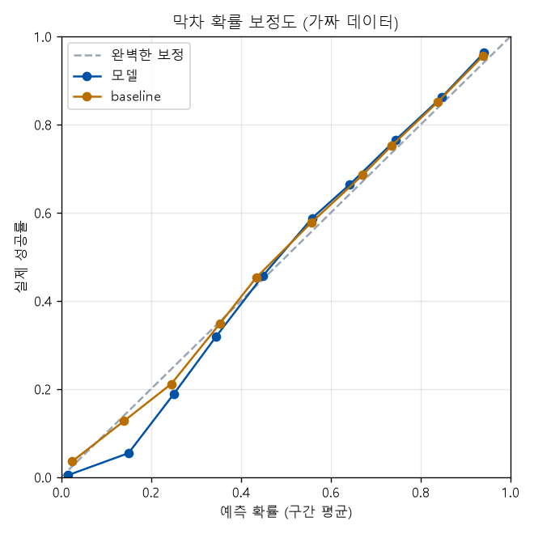

# [주의] 가짜 데이터로 학습한 모델입니다

> **이 리포트의 숫자는 실제 지하철 지연이 아니라 `ml/make_fake_data.py` 가 꾸민 데이터에서 나왔습니다.**
> 학습·리포트·서빙 흐름을 확인하는 용도이며, 확률(예: 94%)은 실제 의미가 없습니다. 발표나 화면에 쓰지 마세요.

# 지연 예측 검증 리포트 `20261119-143546`

- 데이터: **fake** · 학습 51,010줄 (2026-08-01 ~ 2026-09-30) · 시험 11,751줄 (2026-10-01 ~ 2026-10-14)
- 정책값(app_config): 분위수 [0.5, 0.7, 0.8, 0.9, 0.95], 최소 기록 30, 시험 14일
- 예측 단위(시험 기간): {'station': 11751} · 예측한 줄 11,751

## 1. 분위수별 적중률 (실제 지연 ≤ 예측)

목표 분위수에 가까울수록 좋습니다.

| 분위수 | 모델 | baseline |
|---|---|---|
| 0.5 | 0.487 | 0.519 |
| 0.7 | 0.691 | 0.710 |
| 0.8 | 0.798 | 0.806 |
| 0.9 | 0.898 | 0.905 |
| 0.95 | 0.949 | 0.952 |

## 2. 분위수별 핀볼 손실 (작을수록 좋음)

| 분위수 | 모델 | baseline | 모델이 나음 |
|---|---|---|---|
| 0.5 | 0.3686 | 0.4137 | 예 |
| 0.7 | 0.3987 | 0.4310 | 예 |
| 0.8 | 0.3780 | 0.4005 | 예 |
| 0.9 | 0.3192 | 0.3306 | 예 |
| 0.95 | 0.2645 | 0.2693 | 예 |

## 3. 확률 보정도

시험 기간 열차마다 환승 여유 [-0.1, 0.1, 0.4, 0.6, 1.0, 1.5, 1.9, 2.5, 3.2]분을 대 보고 예측 P(지연 ≤ 여유)와 실제 성공을 비교했습니다 (사건 105,759개). 예측 평균과 실제 성공률이 가까울수록 확률을 믿을 수 있습니다.

| 확률 구간 | 모델: 사건 수 | 모델: 예측 평균 | 모델: 실제 성공률 | baseline: 예측 평균 | baseline: 실제 성공률 |
|---|---|---|---|---|---|
| 0.0~0.1 | 21,387 | 0.015 | 0.004 | 0.024 | 0.036 |
| 0.1~0.2 | 8,187 | 0.150 | 0.054 | 0.140 | 0.128 |
| 0.2~0.3 | 7,470 | 0.251 | 0.189 | 0.245 | 0.211 |
| 0.3~0.4 | 7,115 | 0.344 | 0.318 | 0.353 | 0.348 |
| 0.4~0.5 | 7,133 | 0.448 | 0.456 | 0.434 | 0.453 |
| 0.5~0.6 | 5,884 | 0.558 | 0.588 | 0.556 | 0.577 |
| 0.6~0.7 | 5,213 | 0.642 | 0.664 | 0.671 | 0.685 |
| 0.7~0.8 | 7,351 | 0.744 | 0.765 | 0.735 | 0.752 |
| 0.8~0.9 | 10,938 | 0.847 | 0.862 | 0.838 | 0.851 |
| 0.9~1.0 | 25,081 | 0.941 | 0.963 | 0.939 | 0.956 |

## 4. Brier 점수 (작을수록 좋음)

| 모델 | baseline |
|---|---|
| 0.1054 | 0.1241 |

## 읽을 때 주의

- 경로 확률은 구간 확률의 곱입니다(구간 독립 가정). 비 오는 밤처럼 여러 구간이 함께 늦으면 실제보다 높게 나올 수 있습니다.
- 가장 높은 분위수보다 높은 확률은 말하지 않습니다(그 위 꼬리는 모름).
- 강수량과 공휴일은 아직 특징에 없습니다.
